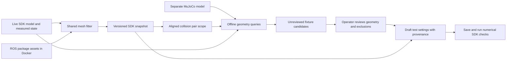

# Robot preparation: geometry and reusable test fixtures

This prototype turns a running robot's description into reusable SDK collision
geometry and, optionally, independently labelled numerical test fixtures. It
exists to remove per-robot mesh setup and hand-written joint arrays from the
normal test workflow.

The same preparation code has been exercised against Mr Handy and Grove G1.
Robot names, morphology and joint counts do not select algorithms. The live
model, declared groups, joint limits and available environment adapters do.



## What has a UI?

**Test settings → Prepare robot** is the prototype UI in the e2e dashboard.
It records geometry, discovers running MuJoCo environments, shows preparation
progress, loads previously recorded bundles, and lets an operator review
candidate fixtures before adding them to draft test settings.

The existing **`ringfour_agent onboard` command remains CLI-only**. Preparation
reuses its mesh-fitting implementation, extracted into
[`ringfour.onboarding`](../ringfour-sdk/ringfour/onboarding.py). The dashboard is
not a wrapper around every CLI option: reach-map sampling is not exposed in this
prototype. Both paths produce the existing `Snapshot` format understood by the
SDK; there is no second geometry format the SDK must learn.

## Operator workflow

1. Open **Robot profile**, enter the agent address, select its effective YAML,
   and inspect the running robot.
2. Open **Test settings → Prepare robot**.
3. Choose **Load a recorded bundle** if geometry for this model was prepared
   before. Bundles are selected by the live description SHA, not just a name.
4. Otherwise choose **Find running simulation environments** and select the
   container that contains the robot's ROS packages and MuJoCo model.
5. Check the optional **Environment settings**. The container must contain the
   collision mesh packages. MuJoCo's model path and Python executable are paths
   *inside that container*. Clear the model path for geometry-only preparation.
6. Choose **Prepare geometry and candidates**. Progress identifies model reads,
   mesh resolution, collision exclusion generation and offline sampling.
7. Check **Geometry: Ready**. Missing assets are reported by link name. An
   incomplete bundle cannot be selected through **Use this geometry for tests**.
8. To use geometry alone, choose **Use this geometry for tests**, then save the
   draft settings. This sets the snapshot search directory for subsequent runs.
9. For collision fixtures, inspect the candidates, source geometry, exclusions
   and simulator coverage. Select the candidates you want and confirm the review
   checkbox. **Add selected fixtures to draft settings** preserves other group
   settings, including movement modes and tool settings.
10. Save the draft. Saving validates named targets against live limits, binds
    reviewed group fixtures to the description SHA, and preserves the previous
    settings through the dashboard's normal backup mechanism.

Preparation and review do not send robot commands. Even a candidate labelled
**Collision pose** is only passed to numerical SDK collision queries. It is not
sent to a controller. Generating a fixture is separate from authorizing movement
probes through the existing group policy and Enable commands controls.

The browser review checkbox is an operator assertion about the geometry and
exclusions. It is not an automatic certificate that two models agree.

## Geometry capture

The test host reads the model through `Robot.description`, preserving the exact
URDF and its SHA. It reads named groups and measured joint context from the live
SDK. If the description changes during preparation, the job rejects the result
as a current bundle.

The Docker adapter resolves ROS package prefixes inside the selected container.
It sources existing ROS/workspace setup files, obtains the ament package index,
resolves mesh URIs and copies collision mesh files to temporary host storage.
`docker cp -L` follows package-install symlinks: copying the symlink itself would
leave a host path pointing into the container's filesystem.

Mesh fitting uses the same implementation as CLI onboarding:

- Read STL vertices and compute oriented bounding volumes.
- Apply the declared mesh scale.
- Compose the fitted volume's transform with the URDF collision origin.
- Keep primitive collision geometry unchanged.
- Expose missing/unreadable mesh geometry rather than invent a volume.

These fitted volumes are **bounding boxes**, not exact mesh collision surfaces.
That matters when comparing with a simulator using convex meshes, capsules or
other primitives. A wider SDK box can report a collision before the simulator
surface does. Review those differences before adopting an independent clear
fixture as an SDK expectation.

Partial mesh resolution on a link does not mark it complete. Unresolved links
remain explicitly unmodelled. Preparation does not produce reachability data.

The SDK collision model builds the existing deterministic structural exclusion
matrix. Its `always_touching` pairs are recorded in the bundle for inspection.
The fixture adapter uses the same pair scope so that comparisons refer to the
same SDK contract. This shares exclusions, **not the collision detector's answers**.
Those exclusions still need review; sampling an exclusion is not independent
proof that a pair should always be ignored.

## Independent MuJoCo fixture sampling

[`mujoco_fixtures.py`](mujoco_fixtures.py) runs under a Python with MuJoCo installed
inside the simulation container. It loads a **separate model and data instance**.
It never attaches to the running simulator, publishes ROS messages, changes live
actuator targets or advances the physical simulation.

The adapter:

1. Loads the specified model and saves a compiled `model.mjb` for provenance.
2. Hashes that compiled model, including the loaded geometry.
3. Matches joints by name and requires compatible scalar joints and finite
   limits. Missing joints/limits produce a group-specific explanation.
4. Applies the captured full joint state as context. A missing named simulator
   joint in that context prevents fixture generation.
5. Samples each group's configuration within the intersection of SDK and
   simulator limits. The seed is recorded and deterministic.
6. Calls `mj_forward` and **direct `mj_geomDistance` queries** for aligned SDK
   self-collision pairs. Penetration below -0.000001 m is labelled collision.
7. Keeps up to three examples for each available label per group, subject to the
   sample budget. Finding a clear or colliding example is not guaranteed.

Direct geometry queries deliberately do not depend on dynamics contact masks.
A simulator may disable robot self-contact for stability while still containing
useful collision geometry. Geometry with both contact flags zero is treated as
visual-only and excluded by this adapter. Unusual exports should be reviewed
against that convention.

The labels mean:

| Label | Evidence | Can enter test settings? |
| --- | --- | --- |
| Clear pose | No penetrations across the complete aligned pair set | After operator review |
| Collision pose | At least one independently detected penetration, with named link pairs | After operator review |
| Unverified pose | No detected penetration, but simulator geometry is missing for one or more relevant pairs | No |

A missing pair cannot prove absence of collision. Positive evidence can still
be useful when other pairs lack coverage; the expected contact pairs are shown.
World geometry is outside this comparison: the SDK query under test is robot
**self-collision**, including its other links and independently positioned groups.
This prototype does not generate navigation goals or prove clearance against
objects in a scene.

A whole-robot collision can exist in the captured context outside the sampled
group. The adapter records expected pairs and context so an operator can see
that, rather than assuming the sampled group caused every collision.

## Bundle layout and cache identity

Local bundles are stored under the ignored dashboard configurations directory:

```text
dashboard/configurations/bundles/
  <robot-name>-<geometry-fingerprint>/
    snapshot/
      <description-sha>/
        description.urdf
        hulls.json
        meta.json
        bundle.json
        fixtures/
          <compiled-model-sha>-<context-fingerprint>/
            model.mjb
            fixtures.json
            request.json
            adapter.py
```

The snapshot search root is `<robot-name>-<geometry-fingerprint>`. Its
`snapshot/<description-sha>` layout follows the SDK's existing `*/<sha>` lookup.

The description SHA protects against model-version mismatches. The geometry
fingerprint separates different fitted collision volumes. Fixture storage also
separates different compiled simulator models and captured full-state contexts.
Changing a robot name alone is not evidence that its geometry changed.

`bundle.json` records:

- Robot identity, description SHA, recording time and geometry fingerprint.
- Snapshot root/path and geometry readiness.
- Unmodelled links, collision pair count and structural exclusions.
- Source container and source simulator model path.
- Reach-map status.
- Fixture generation status, optional error and independent fixture data.

`fixtures.json` records:

- Oracle name/version and method (`direct_geometry_distance`).
- Adapter source hash; the exact adapter source is retained beside its output.
- Compiled model SHA, description SHA, seed and sample budget.
- Penetration threshold.
- Per-group missing-geometry coverage and candidate records.
- Candidate joint values, full context, expected contact pairs and unreviewed
  status.

Loading a cached bundle does not rerun mesh fitting or sampling. It checks the
live model SHA. **Asset changes without a URDF change still require fresh
preparation**: a description SHA cannot prove that a file behind a mesh URI has
remained unchanged. Review the source model/environment when reusing a bundle.

Cached candidates remain unreviewed by default. Accepting fixtures creates
reviewed draft test settings; it does not globally bless every candidate in a
bundle.

The saved model, input and adapter can replay sampling without the original ROS
packages or scene XML, under a compatible MuJoCo Python environment:

```bash
python adapter.py model.mjb request.json /path/to/replay-output
```

The bundle records the SDK version separately. The SDK's development version
string alone is not an exact source revision; preserve the workspace revision
when comparing SDK implementations over time.

## How fixtures enter the suite

Reviewed clear candidates populate:

```yaml
groups:
  example_group:
    clear_configurations:
      - joint_a: 0.2
        joint_b: 0.1
    clear_state:
      independent_mount: 0.4
```

Reviewed collision candidates populate `collision_configurations` and
`collision_state`. The existing numerical checks consume these fields.
Multiple selected poses for one label must share the same full-state context;
otherwise the prototype refuses export instead of silently choosing one context.

`fixture_provenance` records the model/geometry hashes, simulator version,
method, review time and selected candidate IDs. Conformance validation rejects
review evidence for a different live model. Editing or recapturing a fixture in
the UI removes its previous simulator provenance, because the edited pose no
longer has that recorded label.

The existing collision tests currently assert clear/nonempty results; they do
not assert an exact set of contact pairs. Expected pairs remain in the bundle
for review and diagnosis. Exact-pair comparison is a possible next step and
must account for bounding-volume versus simulator-surface differences.

Collision performance budgets remain explicit qualification settings. Capturing
geometry does not invent a latency budget or waive a slow response.

## Existing CLI onboarding

Inside a sourced ROS environment with the agent and robot packages installed:

```bash
ros2 run ringfour_agent onboard \
  --profile /path/to/effective-profile.yaml \
  --out /path/to/profiles \
  --skip-reach
```

Use the effective launch-resolved profile where launch adds interfaces. Omitting
`--skip-reach` requests reachability sampling. Relevant options are:

| Option | Purpose |
| --- | --- |
| `--profile` | Required robot YAML |
| `--out` | Snapshot root; defaults beside the profile |
| `--group` | Group to use for reach sampling |
| `--skip-reach` | Geometry and collision matrix only |
| `--samples` | Reach sampling budget |
| `--resolution` | Reach grid resolution |
| `--force` | Re-record an existing SHA |

CLI onboarding records under `<out>/<profile-file-stem>/<description-sha>`.
Make that output available to the test host, then select the snapshot search
root in Test settings. The dashboard prototype resolves container meshes itself
and therefore does not require installing the whole SDK/agent into a ROS
container just to capture geometry.

A missing Cartesian tip means no Cartesian reach map. CLI onboarding also skips
unsupported state-dependent tip chains with independently controlled joints.
A reach map is optional capability data, not a requirement for a joint-space
robot such as the declared G1 arms/hands.

## Prototype API

All preparation mutations use the dashboard's existing local same-origin JSON
request checks. Endpoints return errors through the same UI notices as settings.

| Endpoint | Purpose |
| --- | --- |
| `GET /api/preparation/environments` | Discover Docker containers with a model viewer's `--model` path |
| `POST /api/preparation/start` | Start one background preparation job |
| `GET /api/preparation/<id>` | Read status, stage, error and result |
| `POST /api/preparation/find` | List stored bundles matching the live model |
| `POST /api/preparation/load` | Load a matching stored bundle as a completed job |
| `POST /api/preparation/review` | Validate review and return draft fixture settings |

Start payload:

```json
{
  "uri": "ws://127.0.0.1:10102",
  "profile": "/path/to/effective-profile.yaml",
  "container": "ros-environment",
  "model": "/path/inside/container/model.xml",
  "python": "/opt/mjviser/bin/python",
  "samples": 100
}
```

The model field is optional. The sample budget is 1–1000 per group. Container
names are validated; subprocess arguments are passed as argv rather than
interpolated shell commands. The ROS setup step uses a fixed script to inspect
package directories.

Find/load/review requests include `uri` and `profile`. Load also includes the
bundle `key`. Review includes the completed `job` ID, `reviewed: true` and a
`selected` list of candidate IDs. The server checks live identity/model binding,
geometry readiness, candidate membership, clear-pose coverage and state-context
consistency. The returned settings are drafts; saving is a separate operation.

Only one preparation job runs at a time, and preparation cannot start while a
suite run is active. Jobs are currently held in memory; bundles persist on disk.
After a dashboard restart, use Load a recorded bundle instead of an old job ID.
There is no cancellation control in this prototype.

## Results on the current robots

These observations are from the 2026-10-08 development session, using the running
simulation models. They are not permanent properties of every configuration of
these robots.

| Robot | Geometry capture | Independent candidates |
| --- | --- | --- |
| Handy | Complete; ROS collision meshes resolved | Clear and colliding arm examples; clear examples for head/lifts |
| Grove G1 | Complete; ROS collision meshes resolved | Full pair coverage after the upstream fixed-link identity correction; current sampled contexts yielded colliding examples |

The initial G1 report of 123 uncovered pairs was a link-identity mismatch, not
absent meshes. Its MJCF attached `head_link` and `logo_link` geometry to
`torso_link`, and `pelvis_contour_link` geometry to `pelvis`. The robot solution
now preserves these names as massless fixed child bodies, with unchanged geom
poses and dynamics. Fresh preparation reports zero uncovered pairs for all
three groups, without a G1-specific mapping rule in the shared adapter.

Snapshot checks loaded the prepared geometry through the ordinary SDK search:
three G1 group checks and five Handy group checks passed. These checks verify
recording/model binding; they do not certify collision-model physical accuracy.

No candidate was physically commanded. No reviewed fixture settings were saved
as part of prototype verification. The previously completed full G1 run retains
its original frozen settings and results; preparation does not rewrite it.

## Remaining work

- For other robot exports, preserve collision-link identities or provide an
  independent geometry source with an explicit, reviewed link mapping.
- Add an optional visual candidate review showing full-state context and named
  contacts; the current UI shows joint values, pairs and coverage.
- Add reach-map preparation controls with correct multi-group/external-state
  semantics; avoid presenting a static reach map as universally valid.
- Add local ROS and other simulator adapters behind the same bundle/review
  contract. The current environment adapter is Docker and the oracle is MuJoCo.
- Consider measured collision-query benchmarks as a report, with an explicit
  acceptance budget when qualification needs one.
- Freeze the selected geometry bundle alongside run artifacts for stronger
  replay guarantees; runs currently freeze the profile/settings and reference
  the selected snapshot root.
- Add job cancellation, cache maintenance and durable environment preferences.

The core rule is unchanged: automate reusable setup, expose missing evidence,
and keep independent verification separate from the implementation under test.
